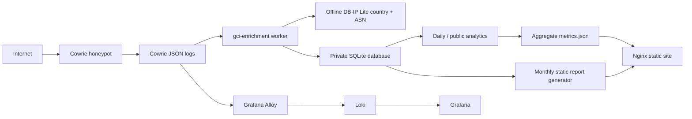

# CloudThreat Observatory

A small GCP-hosted honeypot and public observatory for unsolicited Internet
traffic. Cowrie records SSH/Telnet interactions; a local Python worker enriches
the events with offline country and ASN data; SQLite stores private event and
attacker records; Alloy, Loki, and Grafana provide log search; and a separate
static site publishes aggregate metrics.

The observatory is served from the GCI VM at [http://35.212.201.111/](http://35.212.201.111/).
It is a standalone GCI project and is not part of `alexkomok.clodhost.com` or
`itmarketradar.ca`.

## What it does

- Captures Cowrie session, login, and command events.
- Enriches globally routable source addresses locally with country and ASN
  information; no per-IP lookup requests are sent to DB-IP.
- Stores events, attacker rollups, command-tool classifications, and restart
  offsets in a private SQLite database.
- Collects logs through Alloy into Loki for Grafana panels.
- Publishes today’s aggregate counts and rankings, a 90-day event/source series,
  redacted playback, a heuristic daily highlight, and static monthly reports.
- Refreshes the public metrics feed every five minutes.

## Architecture



The Grafana pipeline and the enrichment pipeline read the same Cowrie JSON log
files independently. Promtail was removed; Alloy is the active collector.

## Repository map

- `index.html`, `styles.css`, `app.js`: standalone observatory UI.
- `enrichment/worker.py`: Cowrie log follower, offline enrichment, SQLite
  rollups, command-tool classification, and profile view creation.
- `enrichment/update_geoip.py`: monthly DB-IP Lite country and ASN updater.
- `enrichment/daily_analytics.py`: private daily analytics snapshots.
- `enrichment/public_metrics.py`: sanitized public feed, timeline, playback, and
  daily unusual-session selection.
- `enrichment/monthly_report.py`: static aggregate report generator.
- `enrichment/*.service`, `enrichment/*.timer`: systemd units and schedules.
- `enrichment/nginx-cloudthreat.conf`: static web server configuration.
- `enrichment/README.md`: service paths and data-source details.
- `docs/`: architecture, operations, data handling, and development notes.

## Deployment summary

The VM runs Ubuntu on GCP. Cowrie is installed under `/opt/cowrie`; enrichment
code is installed under `/opt/gci-enrichment`; the database and GeoIP files are
under `/var/lib/gci-enrichment`; the website is served from
`/var/www/cloudthreat`.

| Service or timer | Purpose | Schedule |
| --- | --- | --- |
| `cowrie` | Honeypot session capture | Continuous |
| `gci-enrichment.service` | Follow Cowrie logs and update SQLite | Continuous |
| `alloy` | Ship Cowrie logs to Loki | Continuous |
| `loki` | Log storage and queries | Continuous |
| `grafana-server` | Dashboards | Continuous |
| `gci-geoip-update.timer` | Update local GeoIP databases | Monthly |
| `gci-daily-analytics.timer` | Private daily top lists | Daily at 00:10 UTC |
| `gci-public-metrics.timer` | Refresh `metrics.json` | Every five minutes |
| `gci-monthly-report.timer` | Publish prior completed month | First day at 00:30 UTC |
| `nginx` | Public static site and aggregate feed | Continuous |

The report index is [http://35.212.201.111/reports/](http://35.212.201.111/reports/).
The first complete monthly report is generated after the first full month of
collection.

## Grafana access

Grafana and Loki are bound to loopback on the VM. Create an SSH tunnel from a
trusted workstation, then open `http://127.0.0.1:3000` locally:

```sh
ssh -N -L 3000:127.0.0.1:3000 gci
```

The `gci` SSH alias uses the management SSH port. Do not expose Grafana or Loki
directly to the public Internet.

## Data and privacy

The private SQLite database contains source addresses, login usernames and
passwords, raw shell commands, session IDs, event timestamps, protocol and port
data, and enrichment. It is mode `0600` and owned by the dedicated
`gci-enricher` account. `attacker_profiles` and `malware_commands` are private
SQLite views.

The public feed omits source addresses, session IDs, raw passwords, raw commands,
and download URLs. The requested top password is published as a single aggregate
value, and username rankings are aggregate counts. Playback labels redact
credentials and command content. Monthly reports contain aggregates only.

See [Data handling and security](docs/data-handling.md) for the full boundary.
The current public endpoint uses HTTP; use TLS if a domain is attached or any
authenticated interaction is added. See [Operations](docs/operations.md) for
firewall and service checks.

## Local preview

The page has no build step or package dependencies. Start a local static server
from the repository root:

```sh
python3 -m http.server 8080
```

Open `http://127.0.0.1:8080/`. Without a local `metrics.json`, the page shows its
waiting state rather than fabricated sample activity. `metrics.json`, VM logs,
database files, GeoIP data, and generated reports are excluded from Git.
